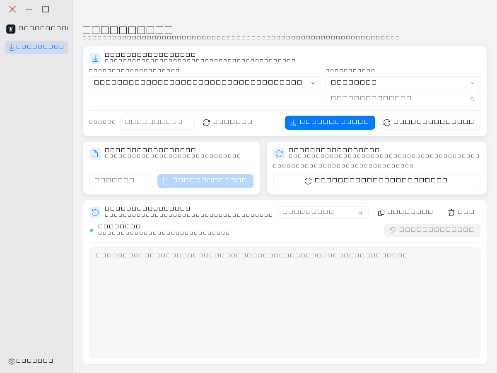

# XenForo Crawler V72

Ứng dụng desktop quét media từ diễn đàn XenForo và tải về ổ. Điều khiển trình duyệt qua Playwright, hỗ trợ Cốc Cốc / Chrome / Edge.



## Tính năng

- **Quét theo chuyên mục**: duyệt toàn bộ thread trong box, giới hạn 5 tab song song
- **Quét theo bài viết**: dán link thread, lấy media ngay trong bài đó
- **Quét đa luồng nhiều user**: bấm một lần, tự động quét toàn bộ user đã có trên ổ
- **Tải song song** 10 request cùng lúc, streaming 64KB (không nạp cả file vào RAM)
- **Cache SQLite** ghi nhớ URL đã tải, lần sau bỏ qua
- **Khử trùng lặp theo nội dung**: cùng ảnh ở 2 URL → hardlink, 0 byte thêm trên ổ
- **Tự động điền tên tác giả + box URL** khi quét bài viết → lần sau không cần gõ lại
- **Tìm kiếm tác giả** trong dropdown theo tên
- **Lưu chuyên mục mới** vào danh sách preset để chọn nhanh lần sau
- **Đổi domain nhanh** khi forum đổi tên miền (ô Domain + nút Áp dụng)
- **Dừng khẩn cấp**: huỷ request đang treo trong ~2 giây
- **Nhật ký có màu**, lọc theo từ khoá, sao chép, xóa
- **Hai bảng màu** sáng/tối, nhớ lựa chọn giữa các lần mở

## Yêu cầu

| Thành phần | Yêu cầu |
|---|---|
| Python | 3.10+ |
| Hệ điều hành | Windows |
| Trình duyệt | Cốc Cốc, Chrome hoặc Edge >= 136 |

## Cài đặt

```bash
git clone https://github.com/iamhieuxz/xenforo.git
cd xenforo

python -m venv .venv
.venv\Scripts\activate

pip install playwright==1.54.0 aiofiles==25.1.0 beautifulsoup4==4.15.0 lxml==6.1.1
```

App dùng Playwright để điều khiển trình duyệt có sẵn trên máy, **không cần** `playwright install`.

## Chạy

### Cách 1: Qua start_app.bat (khuyên dùng)

```bash
start_app.bat
```

Script tự mở Cốc Cốc ở cổng debug 9222 với profile thật (có sẵn cookie đăng nhập), rồi mở app.

> **Lưu ý:** Phải đóng hết Cốc Cốc trước khi chạy. Chromium chỉ đọc cờ `--remote-debugging-port` lúc khởi động.

### Cách 2: Trực tiếp

```bash
python app.py
```

Yêu cầu Cốc Cốc đã được mở ở cổng 9222 trước (hoặc app sẽ tự thử mở).

### Giao diện Tkinter (legacy)

```bash
python v72.py
```

### Thử nghiệm không đụng ổ thật

```bash
set RPHANG_DIR=D:\test-rphang
python app.py
```

## Cách dùng

### Quét theo tác giả

1. Chọn hoặc nhập **Box URL** trong dropdown
2. Chọn hoặc gõ **Tên tác giả** (có ô tìm kiếm để lọc nhanh)
3. Bấm **Quét tác giả**

### Quét bài viết đơn

1. Dán link thread vào ô **Link bài viết**
2. Bấm **Quét bài viết**
3. App tự động điền tên tác giả + box URL vào các ô tương ứng
4. Nếu box chưa có trong danh sách → bấm **Lưu chuyên mục** để thêm

### Quét toàn bộ user

1. Chọn Box URL
2. Bấm **Quét lại tất cả tác giả** — app tự quét mọi user đã có trên ổ

### Đổi domain

Khi forum đổi tên miền (vd: `rphang.beer` → `rphang.show`):

1. Gõ domain mới vào ô **Domain**
2. Bấm **Áp dụng** — mọi preset và URL đang nhập tự động cập nhật

### Reload danh sách tác giả

Sau khi quét xong, bấm **Reload tác giả** để cập nhật dropdown mà không cần khởi động lại app.

## Cấu trúc dự án

```
xenforo/
├── app.py                     # Điểm vào chính
├── gui_fluent.py              # Shim tương thích ngược
├── v72.py                     # GUI Tkinter (legacy)
├── config.py                  # Cấu hình tập trung
│
├── engine.py                  # Điều phối quét (box → thread → post)
├── downloader.py              # Tải file song song, streaming, hardlink
├── fast_fetch.py              # HTTP streaming (nhanh hơn trình duyệt)
├── xenforo_parse.py           # Bóc DOM XenForo (hàm thuần)
├── xf_selectors.py            # Regex/hằng số cho parser
├── cache.py                   # SQLite cache + content hash
├── browser_launcher.py        # Quản lý trình duyệt CDP
├── session_source.py          # Profile trình duyệt
├── session_log.py             # Nhật ký phiên ra file
├── check_log.py               # Đọc/lọc nhật ký
├── clean_duplicates.py        # Dọn file trùng theo nội dung
├── open_debug_chrome.py/.bat  # Mở Chrome ở cổng 9222
├── start_app.bat              # Khởi động app + mở trình duyệt
├── requirements.txt
│
├── ui/                        # Giao diện Fluent Design (PySide6)
│   ├── main_window.py         # Cửa sổ chính
│   ├── crawler_view.py        # Trang quét
│   ├── settings_view.py       # Trang cài đặt
│   ├── log_view.py            # Widget nhật ký
│   ├── worker.py              # QThread chạy engine
│   └── theme.py               # Theme, widget tùy chỉnh
│
├── tests/                     # Unit tests (295 test)
├── probes/                    # Script kiểm chứng đầu-cuối
├── tools/                     # Công cụ phụ trợ
└── assets/                    # Screenshot, tài nguyên
```

## Cấu hình

Toàn bộ tham số nằm trong `config.py`:

| Biến | Mặc định | Ý nghĩa |
|---|---|---|
| `DOWNLOAD_DIR` | `E:\HIDE\RPHANG` | Thư mục gốc. Ghi đè bằng `RPHANG_DIR` |
| `BROWSER_MODE` | `cdp` | `cdp` (cổng 9222) hoặc `persistent` (tự mở) |
| `USE_REAL_PROFILE` | `True` | Dùng profile thật của trình duyệt (có sẵn cookie) |
| `CDP_PORT` | `9222` | Cổng debug CDP |
| `BLOCK_IMAGES` | `True` | Chặn ảnh/font ở tầng mạng (giảm RAM) |
| `TAB_SEM` | `5` | Số tab Playwright đồng thời |
| `DOWNLOAD_SEM` | `10` | Số request tải đồng thời |
| `HTTP_WORKERS` | `12` | Số luồng HTTP-first |
| `MAX_FILE_MB` | `512` | Trần kích thước tệp (0 = không giới hạn) |
| `DOMAIN_OVERRIDE` | `""` | Domain thay thế (đặt qua GUI hoặc `V72_DOMAIN`) |

## Kiểm thử

```bash
python -m unittest test_v72 test_review_fixes test_persistent_mode test_first_login test_gui_fluent test_review_round2 test_review_round3 test_critical_fixes test_log_improvements
```

**295 test**, chạy khoảng 30 giây.

Kiểm tra tĩnh:

```bash
python -m pyflakes *.py ui/*.py
```

## Xử lý sự cố

### "browser.exe thoát ngay sau khi mở (mã 0)"

Cốc Cốc đang chạy nhưng không có cổng debug 9222. Giải pháp:
- Đóng hết Cốc Cốc rồi chạy `start_app.bat`
- Hoặc chạy `open_debug_chrome.py` trước

### "Cổng 9222 bị tiến trình khác chiếm"

Một tiến trình khác đang giữ cổng 9222. Đổi `CDP_PORT` trong `config.py` hoặc tắt tiến trình đó.

### Đổi theme xong mở lại vẫn ra theme cũ

Xóa file theme rồi chọn lại:
```bash
del "%USERPROFILE%\.xenforo_theme"
del .xenforo_theme
```

### File tải về bị lỗi 403/404

- **403**: verify token hết hạn hoặc server chặn. Thử đổi domain (ô Domain → Áp dụng)
- **404**: file đã bị xóa khỏi server. Không thể khắc phục.

## Giới hạn đã biết

- Chỉ chạy trên Windows
- Streaming chỉ có ở đường HTTP; đường Playwright fallback nạp trọn payload vào RAM
- Media chỉ lấy từ nội dung bài viết (không avatar, chữ ký, emoji)
- Thread nhiều trang phải render từng trang nên chậm với bài dài
